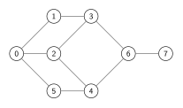
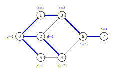
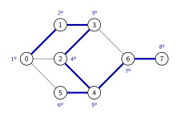
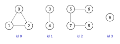
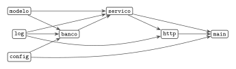
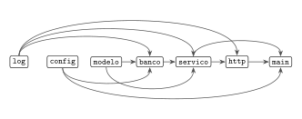
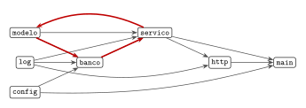
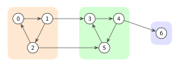

# Representação e percursos em grafos

[Slides desta aula (PDF)](12/00_grafos/grafos.pdf)

## Bibliografia recomendada para o tema

* SEDGEWICK, R.; WAYNE, K. **Algorithms**, 4th ed., seções 4.1 (*Undirected
  Graphs*) e 4.2 (*Directed Graphs*);
* CORMEN, T. et al. **Introduction to Algorithms**, 3rd ed., cap. 22
  (*Elementary Graph Algorithms*), seções 22.1 a 22.5;
* [algs4 - Undirected Graphs](https://algs4.cs.princeton.edu/41graph/) e
  [algs4 - Directed Graphs](https://algs4.cs.princeton.edu/42digraph/);
* visualizações interativas da USF para a
  [busca em largura](https://www.cs.usfca.edu/~galles/visualization/BFS.html),
  a [busca em profundidade](https://www.cs.usfca.edu/~galles/visualization/DFS.html),
  as [componentes conexas](https://www.cs.usfca.edu/~galles/visualization/ConnectedComponent.html)
  e a [ordenação topológica](https://www.cs.usfca.edu/~galles/visualization/TopoSortDFS.html).

## Objetivos da aula

Ao final desta aula você deve ser capaz de:

1. Usar a terminologia básica de grafos: vértice, aresta, grau, caminho, ciclo,
   grafo conexo, componente conexa, grafo dirigido;
2. Representar um grafo por matriz de adjacência e por listas de adjacência, e
   escolher entre as duas pelo custo de memória e de cada operação;
3. Executar à mão a busca em largura e a busca em profundidade a partir de um
   vértice, registrando a ordem de visita e o vetor `pai`;
4. Explicar por que a busca em largura encontra o caminho com menos arestas, e a
   busca em profundidade não;
5. Usar a busca em profundidade para encontrar as componentes conexas e para
   detectar ciclos;
6. Obter uma ordenação topológica de um grafo dirigido acíclico pela pós-ordem
   invertida da busca em profundidade;
7. Reconhecer as componentes fortemente conexas de um grafo dirigido pequeno.

Este conteúdo cai na Prova 2.

## 1. Um labirinto

O programa `labirinto.go` ([ver no GitHub](https://github.com/tads-ufpr-alexkutzke/ds143-material/blob/main/src/12/demo/labirinto.go))
procura um caminho de `S` até `E` no mesmo labirinto com duas buscas diferentes,
e marca com pontos o caminho que cada uma encontrou:

```bash
cd 12/demo
go run labirinto.go
```

```
Busca em largura
  #####################
  #S....   #          #
  #    .   #   ####   #
  #####.   #      #   #
  #  ...   #####  #   #
  #  .###             #
  #E..  #             #
  #####################
  caminho de 13 passos, 43 células visitadas

Busca em profundidade
  #####################
  #S.......#          #
  #       .#   ####   #
  #####   .#      #   #
  #  ......#####  #   #
  #  .###.............#
  #E..  #.............#
  #####################
  caminho de 45 passos, 48 células visitadas
```

<details>
<summary>Código completo de <code>labirinto.go</code></summary>

```go
{{#include 12/demo/labirinto.go}}
```
</details>

As duas buscas visitaram quase o mesmo número de células, e as duas chegaram a
`E`. A busca em largura achou um caminho de 13 passos, e não existe caminho mais
curto nesse labirinto. A busca em profundidade achou um de 45, que passa
pela região da direita antes de voltar para `E`.

O programa não sabe nada de labirintos além de uma regra: de uma célula livre
se passa para as células livres vizinhas. As duas buscas desta aula trabalham
com qualquer estrutura descrita por uma regra desse tipo, que é um **grafo**. A
seção 9 volta a este programa.

## 2. Grafos

Um **grafo** $G = (V, E)$ é formado por um conjunto $V$ de **vértices** e um
conjunto $E$ de **arestas**, e cada aresta liga dois vértices. Seguindo o
Sedgewick, as letras $V$ e $E$ também indicam o número de vértices e o número
de arestas, como em "a busca custa $O(V + E)$".



Este grafo, que vamos chamar de $G$, tem 8 vértices e 10 arestas, e é o exemplo
das seções 3 a 5. O desenho não faz parte do grafo: as posições dos vértices
são escolhidas para facilitar a leitura, e o mesmo grafo pode ser desenhado de
muitas formas. O que define o grafo é a lista de arestas.

### Terminologia

| Termo | Definição | Em $G$ |
|---|---|---|
| vértices **adjacentes** (vizinhos) | ligados por uma aresta | 2 e 4 |
| **grau** de um vértice | número de arestas que tocam o vértice | 3 tem grau 3, 7 tem grau 1 |
| **caminho** | sequência de vértices em que cada um é adjacente ao seguinte | 0, 2, 4, 6 |
| **comprimento** de um caminho | número de arestas do caminho | o caminho acima tem comprimento 3 |
| **ciclo** | caminho com pelo menos uma aresta, que começa e termina no mesmo vértice, sem repetir arestas | 0, 1, 3, 2, 0 |
| grafo **conexo** | existe caminho entre quaisquer dois vértices | $G$ é conexo |
| **componente conexa** | conjunto máximo de vértices ligados entre si por caminhos | $G$ tem uma só |

Nesta aula, os grafos não têm aresta de um vértice para ele mesmo (**laço**,
*self-loop*) nem duas arestas entre o mesmo par de vértices (**arestas
paralelas**). Com essa restrição, um grafo com $V$ vértices tem no máximo
$V(V-1)/2$ arestas. Um grafo com número de arestas próximo desse máximo é
**denso**; um com número de arestas da ordem de $V$ é **esparso**. A maior
parte dos grafos de aplicações reais é esparsa: um cruzamento de ruas tem
quatro vizinhos, e não milhares.

Cada aresta contribui com 1 para o grau de cada uma das duas pontas. A soma dos
graus de todos os vértices é, portanto, $2E$. Em $G$, os graus são 3, 2, 3, 3,
3, 2, 3 e 1, que somam 20, o dobro de 10. Essa conta reaparece no custo das
buscas.

### Árvores são grafos

Uma **árvore** é um grafo conexo e sem ciclos. As árvores das aulas anteriores
são árvores nesse sentido, com um vértice escolhido como raiz. Em um grafo
qualquer, não há raiz, nem filhos à esquerda e à direita, e pode haver mais de
um caminho entre dois vértices. Essa última diferença é a que muda os
algoritmos desta aula em relação aos percursos em árvores.

Uma árvore com $V$ vértices tem exatamente $V - 1$ arestas. Um conjunto de
árvores, sem ligação entre si, é uma **floresta**.

### Grafos dirigidos

Em um **grafo dirigido** (*directed graph*, ou *digraph*), cada aresta tem
sentido: o **arco** $v \to w$ permite ir de $v$ a $w$, e não de $w$ a $v$. O
grau de um vértice se divide em **grau de saída**, o número de arcos que saem
dele, e **grau de entrada**. As seções 7 e 8 tratam desses grafos.

### Onde aparecem

| Aplicação | Vértices | Arestas |
|---|---|---|
| malha viária | cruzamentos | trechos de rua; dirigido, se houver mão única |
| rede social | pessoas | amizade; dirigido, se for "seguir" |
| web | páginas | links, dirigido |
| dependências de software | pacotes | "A importa B", dirigido |
| labirinto ou mapa em grade | células livres | passagem entre células vizinhas |

As duas próximas aulas acrescentam um **peso** a cada aresta, como a distância
de um trecho de rua. Nesta aula as arestas não têm peso.

## 3. Representação

Os vértices são numerados de 0 a $V - 1$, e o número do vértice serve de índice
para os vetores. É a mesma convenção do Union-Find, em que `id[p]` guardava a
informação do item `p`.

O programa `representacao.go` ([ver no GitHub](https://github.com/tads-ufpr-alexkutzke/ds143-material/blob/main/src/12/codes/representacao.go))
monta o grafo $G$ nas duas representações mais usadas, a partir da lista de
arestas:

```bash
cd 12/codes
go run representacao.go
```

<details>
<summary>Código completo de <code>representacao.go</code></summary>

```go
{{#include 12/codes/representacao.go}}
```
</details>

### Matriz de adjacência

A **matriz de adjacência** (*adjacency matrix*) é uma matriz $V \times V$ de
valores lógicos, em que a posição $(v, w)$ indica se existe a aresta $v$-$w$:

```go
type Matriz struct {
    adj [][]bool
}

func (g *Matriz) AdicionaAresta(v, w int) {
    g.adj[v][w] = true
    g.adj[w][v] = true
}
```

Em um grafo não dirigido, cada aresta aparece duas vezes, e a matriz é
simétrica:

```
Matriz de adjacência
     0 1 2 3 4 5 6 7
  0  . 1 1 . . 1 . .
  1  1 . . 1 . . . .
  2  1 . . 1 1 . . .
  3  . 1 1 . . . 1 .
  4  . . 1 . . 1 1 .
  5  1 . . . 1 . . .
  6  . . . 1 1 . . 1
  7  . . . . . . 1 .
```

Saber se a aresta $v$-$w$ existe custa uma consulta, `adj[v][w]`. Em
compensação, a matriz ocupa $V^2$ posições, qualquer que seja o número de
arestas, e listar os vizinhos de um vértice exige percorrer a linha inteira,
com $V$ posições.

### Listas de adjacência

As **listas de adjacência** (*adjacency lists*) guardam, para cada vértice, só
os seus vizinhos. Em Go, um *slice* de *slices*:

```go
type Grafo struct {
    adj [][]int
}

func NovoGrafo(n int) *Grafo {
    return &Grafo{adj: make([][]int, n)}
}

func (g *Grafo) V() int { return len(g.adj) }

func (g *Grafo) AdicionaAresta(v, w int) {
    g.adj[v] = append(g.adj[v], w)
    g.adj[w] = append(g.adj[w], v)
}
```

```
Listas de adjacência
  0: [1 2 5]
  1: [0 3]
  2: [0 3 4]
  3: [1 2 6]
  4: [2 5 6]
  5: [0 4]
  6: [3 4 7]
  7: [6]
```

Cada aresta também aparece duas vezes, uma na lista de cada ponta, e o total de
posições nas listas é a soma dos graus, $2E$. Os vizinhos ficaram em ordem
crescente porque as arestas foram inseridas em ordem crescente. Os programas
desta aula visitam os vizinhos na ordem da lista, e a ordem das listas muda a
ordem das buscas.

### Comparação

| Operação | Matriz | Listas |
|---|---|---|
| memória | $V^2$ | $V + 2E$ |
| inserir a aresta $v$-$w$ | $O(1)$ | $O(1)$ |
| saber se a aresta $v$-$w$ existe | $O(1)$ | $O(\text{grau}(v))$ |
| percorrer os vizinhos de $v$ | $O(V)$ | $O(\text{grau}(v))$ |

As buscas desta aula fazem uma única coisa com o grafo: percorrem os vizinhos
de cada vértice. Para elas, e para grafos esparsos, as listas são a escolha
usual. Um exemplo com números: um grafo de 1 milhão de cruzamentos, cada um com
4 vizinhos em média. As listas guardam $4 \times 10^6$ inteiros de 8 bytes, 32
MB, mais o cabeçalho de 24 bytes de cada *slice*, outros 24 MB. A matriz, com
um `bool` de 1 byte por posição, ocupa $10^{12}$ bytes, 1 TB.

A matriz é a escolha quando o grafo é denso, ou quando a operação mais
frequente é perguntar se uma aresta existe.

Há uma terceira representação, a própria **lista de arestas**, como a que os
programas recebem. Ela não serve para as buscas, porque achar os vizinhos de um
vértice exige percorrer todas as arestas, mas é a entrada do algoritmo de
Kruskal, na aula sobre árvores geradoras mínimas.

### Vértices com nome

Quando os vértices têm nome, como pacotes ou cidades, um `map[string]int` dá o
número de cada nome, e um `[]string` faz o caminho inverso:

```go
var indice = map[string]int{}
var nomes []string

func numero(nome string) int {
    if v, ok := indice[nome]; ok {
        return v
    }
    indice[nome] = len(nomes)
    nomes = append(nomes, nome)
    return len(nomes) - 1
}
```

É uma aplicação direta da tabela de dispersão da aula anterior. O programa da
seção 7 usa só o `[]string`, porque os nomes são fixos.

## 4. Busca em largura

A **busca em largura** (*breadth-first search*, BFS) a partir de um vértice $s$
visita primeiro $s$, depois todos os vizinhos de $s$, depois todos os vizinhos
desses vizinhos, e assim por diante. Os vértices esperam a vez em uma **fila**:

```go
func BuscaEmLargura(g *Grafo, s int) *BFS {
    b := &BFS{
        marcado: make([]bool, g.V()),
        pai:     make([]int, g.V()),
        dist:    make([]int, g.V()),
    }
    b.pai[s] = -1
    b.marcado[s] = true
    fila := []int{s}
    for len(fila) > 0 {
        v := fila[0]
        fila = fila[1:]
        for _, w := range g.adj[v] {
            if !b.marcado[w] {
                b.marcado[w] = true
                b.pai[w] = v
                b.dist[w] = b.dist[v] + 1
                fila = append(fila, w)
            }
        }
    }
    return b
}
```

O vetor `marcado` registra os vértices que já entraram na fila. Sem ele, a
busca entraria em ciclo: em $G$, o 0 põe o 1 na fila, o 1 põe o 0, e assim sem
fim. O vetor `pai` registra por qual aresta cada vértice foi alcançado, e
`dist`, a quantas arestas ele está de $s$.

O percurso em largura do material de árvores é este mesmo algoritmo, sem o
vetor `marcado`. Em uma árvore, cada nó é alcançado por um único caminho a
partir da raiz, e nenhum nó entra duas vezes na fila. Em um grafo, isso deixa
de valer.

### Execução em $G$, a partir de 0

O programa `bfs.go` ([ver no GitHub](https://github.com/tads-ufpr-alexkutzke/ds143-material/blob/main/src/12/codes/bfs.go))
imprime a fila depois de cada vértice retirado:

```bash
go run bfs.go
```

```
Busca em largura a partir de 0
  retira 0   fila: [1 2 5]
  retira 1   fila: [2 5 3]
  retira 2   fila: [5 3 4]
  retira 5   fila: [3 4]
  retira 3   fila: [4 6]
  retira 4   fila: [6]
  retira 6   fila: [7]
  retira 7   fila: []

  v | dist | pai
  --+------+----
  0 |    0 |  -1
  1 |    1 |   0
  2 |    1 |   0
  3 |    2 |   1
  4 |    2 |   2
  5 |    1 |   0
  6 |    3 |   3
  7 |    4 |   6

Caminho de 0 até 7: [0 1 3 6 7]
```

<details>
<summary>Código completo de <code>bfs.go</code></summary>

```go
{{#include 12/codes/bfs.go}}
```
</details>

Ao retirar o 2, a busca encontra o 0 e o 3 já marcados, e só o 4 entra na fila.
Ao retirar o 5, os dois vizinhos já estão marcados, e nada entra. As arestas
`pai[w]`-`w` formam uma árvore, a **árvore da busca em largura**, destacada na
figura com a distância de cada vértice:



### Caminho com menos arestas

Os vértices saem da fila em ordem crescente de distância: primeiro $s$, depois
todos os vértices à distância 1, depois todos à distância 2. Um vértice à
distância $d + 1$ só entra na fila quando um vizinho dele, à distância $d$, é
retirado, e a essa altura todos os vértices mais próximos já entraram. Por isso
`dist[v]` é o menor número de arestas de um caminho de $s$ até $v$, e o caminho
que o vetor `pai` dá é um caminho com esse número de arestas.

Para obter o caminho até $v$, sobe-se pelo vetor `pai` até $s$, e inverte-se a
sequência com `slices.Reverse`:

```go
func (b *BFS) Caminho(v int) []int {
    if !b.marcado[v] {
        return nil
    }
    var cam []int
    for x := v; x != -1; x = b.pai[x] {
        cam = append(cam, x)
    }
    slices.Reverse(cam)
    return cam
}
```

O caminho de 0 até 7 tem 4 arestas. Existe outro caminho com 4 arestas, 0, 2,
3, 6, 7, e a busca devolve um deles, decidido pela ordem das listas. O que a
busca garante é o número de arestas, e não um caminho específico.

### Custo

Cada vértice entra na fila uma vez, porque é marcado ao entrar. Cada lista de
adjacência é percorrida uma vez, quando o vértice dono dela é retirado. Com
listas de adjacência, o custo total é a soma dos tamanhos das listas, $2E$,
mais o trabalho constante de cada vértice: $O(V + E)$. Com matriz, percorrer os
vizinhos de cada vértice custa $V$, e a busca custa $O(V^2)$.

## 5. Busca em profundidade

A **busca em profundidade** (*depth-first search*, DFS) a partir de $v$ marca
$v$ e, para cada vizinho ainda não marcado, faz uma busca em profundidade a
partir dele, antes de passar ao vizinho seguinte:

```go
func (d *DFS) visita(v int) {
    d.marcado[v] = true
    for _, w := range d.g.adj[v] {
        if !d.marcado[w] {
            d.pai[w] = v
            d.visita(w)
        }
    }
}
```

A busca vai o mais longe possível por um caminho, e só volta quando encontra um
vértice sem vizinhos novos. A volta é a da recursão: a pilha de chamadas faz o
papel da fila da busca em largura.

### Execução em $G$, a partir de 0

O programa `dfs.go` ([ver no GitHub](https://github.com/tads-ufpr-alexkutzke/ds143-material/blob/main/src/12/codes/dfs.go))
imprime uma linha quando cada chamada começa e outra quando termina, recuadas
pela profundidade da recursão:

```bash
go run dfs.go
```

```
Busca em profundidade a partir de 0
  visita(0)
    visita(1)
      visita(3)
        visita(2)
          visita(4)
            visita(5)
            termina 5
            visita(6)
              visita(7)
              termina 7
            termina 6
          termina 4
        termina 2
      termina 3
    termina 1
  termina 0

Pré-ordem: [0 1 3 2 4 5 6 7]
Pós-ordem: [5 7 6 4 2 3 1 0]
```

<details>
<summary>Código completo de <code>dfs.go</code></summary>

```go
{{#include 12/codes/dfs.go}}
```
</details>

Da visita ao 3, a busca segue para o 2, primeiro vizinho não marcado da lista
`[1 2 6]`, e não para o 6. O 6 só é alcançado mais tarde, pelo 4. A árvore da
busca em profundidade, com a ordem em que cada vértice foi visitado:



O caminho de 0 até 7 pelo vetor `pai` desta busca é 0, 1, 3, 2, 4, 6, 7, com 6
arestas, contra as 4 da busca em largura. A busca em profundidade encontra *um*
caminho, sem garantia nenhuma sobre o número de arestas.

### Pré-ordem e pós-ordem

As duas ordens do material de árvores reaparecem aqui. A **pré-ordem** registra
cada vértice quando a chamada dele começa, e a **pós-ordem**, quando ela
termina. Na pós-ordem, um vértice só aparece depois de todos os vértices
alcançados a partir dele na mesma chamada: o 4 aparece depois do 5, do 6 e do 7.
A seção 7 usa a pós-ordem para ordenar as dependências de um projeto.

### Custo

A análise é a da busca em largura: cada vértice é visitado uma vez, e cada
lista é percorrida uma vez. Com listas de adjacência, o custo é $O(V + E)$.

## 6. Componentes conexas e ciclos

### Componentes conexas

Uma busca a partir de $s$ marca exatamente os vértices alcançáveis a partir de
$s$, que formam a componente conexa de $s$. Para encontrar todas as
componentes, basta iniciar uma busca a partir de cada vértice que ainda não foi
marcado, e dar um número novo a cada busca iniciada:

```go
quantas := 0
for v := 0; v < g.V(); v++ {
    if !marcado[v] {
        visita(v, quantas) // marca v e todo vértice alcançável, com id = quantas
        quantas++
    }
}
```



O programa `componentes.go` ([ver no GitHub](https://github.com/tads-ufpr-alexkutzke/ds143-material/blob/main/src/12/codes/componentes.go))
faz isso com o grafo da figura:

```bash
go run componentes.go
```

```
Grafo com 10 vértices e 8 arestas: 4 componentes

  v  | 0 1 2 3 4 5 6 7 8 9
  id | 0 0 0 1 1 2 2 2 2 3

0 e 2 na mesma componente? true
2 e 5 na mesma componente? false

Ciclo: a aresta 2-0 leva a um vértice já marcado
Sem as arestas 1-2 e 7-8, tem ciclo? false
```

<details>
<summary>Código completo de <code>componentes.go</code></summary>

```go
{{#include 12/codes/componentes.go}}
```
</details>

O vetor `id` tem o mesmo papel do `id` do Quick-Find: dois vértices estão
conectados se, e somente se, `id[v] == id[w]`. A diferença está em quando o
grafo é conhecido. A busca precisa do grafo inteiro guardado, calcula todas as
componentes em $O(V + E)$, e depois responde cada consulta em $O(1)$. O
Union-Find recebe as arestas uma de cada vez, sem guardá-las, e responde
consultas entre uma aresta e outra. É esse segundo uso que o algoritmo de
Kruskal faz na próxima aula.

### Detecção de ciclo

Durante a busca em profundidade, cada aresta $v$-$w$ examinada leva a um de
três casos:

* $w$ não está marcado: a busca desce para $w$;
* $w$ está marcado e é o pai de $v$: é a própria aresta pela qual a busca
  chegou a $v$, vista do outro lado;
* $w$ está marcado e não é o pai de $v$: existe outro caminho de $w$ até $v$,
  pela árvore da busca, e a aresta $v$-$w$ fecha um ciclo.

```go
for _, w := range g.adj[v] {
    if !marcado[w] {
        // desce para w, com v como pai
    } else if w != pai {
        // ciclo
    }
}
```

No grafo da figura, a busca desce de 0 para 1 e de 1 para 2. Na lista do 2, o
0 já está marcado e não é o pai do 2, que é o 1: a aresta 2-0 fecha o ciclo 0,
1, 2. Sem as arestas 1-2 e 7-8, cada componente vira uma árvore, e a busca não
encontra ciclo.

## 7. Grafos dirigidos e ordenação topológica

Em um grafo dirigido, o arco $v \to w$ entra só na lista de $v$:

```go
func (g *Digrafo) AdicionaArco(v, w int) {
    g.adj[v] = append(g.adj[v], w)
}
```

As duas buscas funcionam sem mudança nenhuma, seguindo os arcos no sentido
deles. A busca a partir de $s$ marca os vértices **alcançáveis** a partir de
$s$. Em um grafo dirigido, $w$ pode ser alcançável a partir de $v$ sem que $v$
seja alcançável a partir de $w$.

### Dependências entre pacotes

Um projeto Go tem sete pacotes. O arco $B \to A$ significa que $A$ importa $B$,
e por isso $B$ precisa ser compilado antes de $A$:



Uma **ordenação topológica** (*topological sort*) de um grafo dirigido é uma
ordem dos vértices em que todo arco aponta para a frente: se existe o arco
$v \to w$, $v$ vem antes de $w$. Aqui, é uma ordem de compilação que nunca
compila um pacote antes de algum pacote que ele importa.

### Pós-ordem invertida

Em um grafo dirigido sem ciclo, quando a chamada de $v$ termina, todos os
vértices alcançáveis a partir de $v$ já terminaram, porque ou foram visitados
dentro da chamada de $v$, ou já tinham terminado antes dela começar. Na
pós-ordem, portanto, todo vértice aparece depois de todos os que ele alcança.
Invertida, a pós-ordem põe cada vértice antes de todos os que ele alcança, e é
uma ordenação topológica.

O programa `topologica.go` ([ver no GitHub](https://github.com/tads-ufpr-alexkutzke/ds143-material/blob/main/src/12/codes/topologica.go))
inicia uma busca a partir de cada vértice ainda não visitado, como em
componentes conexas, e inverte a pós-ordem:

```bash
go run topologica.go
```

```
Arcos (B -> A: A importa B)
  modelo   -> [banco servico]
  config   -> [banco main]
  log      -> [banco servico http]
  banco    -> [servico]
  servico  -> [http main]
  http     -> [main]
  main     -> []

Ordem de compilação: [log config modelo banco servico http main]

Com modelo importando servico:
  ciclo: [modelo banco servico]
```

<details>
<summary>Código completo de <code>topologica.go</code></summary>

```go
{{#include 12/codes/topologica.go}}
```
</details>

Com os pacotes nessa ordem, da esquerda para a direita, todos os arcos apontam
para a direita:



A ordenação topológica não é única. `config, log, modelo, banco, servico, http,
main` também respeita todos os arcos. A busca devolve uma delas, decidida pela
ordem dos vértices e das listas.

### Ciclos em grafos dirigidos

Se o pacote `modelo` passar a importar o `servico`, surge o arco
`servico -> modelo`, e o grafo passa a ter o ciclo `modelo -> banco -> servico
-> modelo`. Nenhuma ordem de compilação resolve: cada pacote do ciclo precisa
vir antes do seguinte. Uma ordenação topológica existe se, e somente se, o grafo
dirigido não tem ciclo. Um grafo dirigido sem ciclo é um **DAG** (*directed
acyclic graph*).



A regra da seção 6, "vértice já marcado que não é o pai", não serve em grafo
dirigido. No grafo dos pacotes sem ciclo, a busca a partir de `modelo` termina
o `servico` pelo caminho `modelo -> banco -> servico`, e depois examina o arco
`modelo -> servico`, que leva a um vértice marcado e não fecha ciclo nenhum.

O que distingue um ciclo é o arco para um vértice cuja chamada **ainda não
terminou**. Por isso o `topologica.go` dá a cada vértice um de três estados:

* **branco**: ainda não visitado;
* **cinza**: visitado, com a chamada ainda em andamento, ou seja, na pilha de
  chamadas;
* **preto**: chamada terminada.

Um arco $v \to w$ com $w$ cinza significa que $v$ foi alcançado a partir de
$w$, e o arco volta para $w$: é um ciclo. Seguindo o vetor `pai` de $v$ até $w$,
obtém-se o ciclo inteiro, como o programa faz. Um arco para um vértice preto,
como o `modelo -> servico` acima, não fecha ciclo.

O compilador de Go faz essa verificação. Com dois pacotes que se importam
mutuamente, `go build` termina com a mensagem `import cycle not allowed`, e
mostra a sequência de importações que fecha o ciclo.

## 8. Componentes fortemente conexas

Em um grafo dirigido, dois vértices $v$ e $w$ são **fortemente conectados**
quando $w$ é alcançável a partir de $v$ e $v$ é alcançável a partir de $w$. Uma
**componente fortemente conexa** (*strongly connected component*) é um conjunto
máximo de vértices fortemente conectados entre si.



Neste grafo, de qualquer vértice entre 0, 1 e 2 se chega aos outros dois pelo
ciclo, e o mesmo vale para 3, 4 e 5. Do 3 não se volta ao 1: não há arco saindo
de 3, 4 ou 5 em direção a 0, 1 ou 2. O 6 forma uma componente sozinho, porque
dele não sai arco nenhum.

Em uma cidade com ruas de mão única, cada componente fortemente conexa é um
conjunto de cruzamentos em que se pode ir de qualquer um a qualquer outro e
voltar. Se a cidade inteira não for uma componente só, existe algum cruzamento
de onde não se volta ao ponto de partida.

Trocando cada componente por um vértice só, o grafo resultante não tem ciclo:
um ciclo entre componentes juntaria as duas em uma componente maior. No
exemplo, o resultado tem três vértices e dois arcos, da componente de 0, 1 e 2
para a de 3, 4 e 5, e desta para o 6.

Os algoritmos de Kosaraju-Sharir e de Tarjan encontram as componentes
fortemente conexas em $O(V + E)$, os dois com busca em profundidade. Eles não
fazem parte desta disciplina; as referências estão na seção 4.2 do Sedgewick e
na seção 22.5 do Cormen.

## 9. De volta ao labirinto

O `labirinto.go` não monta listas de adjacência. Cada célula livre é um vértice,
identificado pelo número `linha*colunas + coluna`, e a função `vizinhos`
calcula as células livres vizinhas quando a busca pede:

```go
func vizinhos(v int) []int {
    l, c := v/colunas, v%colunas
    var viz []int
    for _, d := range [][2]int{{0, 1}, {1, 0}, {0, -1}, {-1, 0}} {
        nl, nc := l+d[0], c+d[1]
        if mapa[nl][nc] != '#' {
            viz = append(viz, celula(nl, nc))
        }
    }
    return viz
}
```

Um grafo dado por uma regra que calcula os vizinhos, e não por listas guardadas,
é chamado de **grafo implícito**. As buscas não mudam: `bfs` e `dfs` chamam
`vizinhos(v)` onde o código da seção 4 percorria `g.adj[v]`.

Com o vocabulário desta aula, a demonstração tem explicação:

* o caminho da busca em largura tem 13 passos porque `dist[E]` é 13, o menor
  número de arestas entre `S` e `E`;
* a busca em profundidade testa os vizinhos na ordem direita, abaixo, esquerda,
  acima. A partir de `S`, ela vai para a direita até a parede, desce ao lado dela,
  e segue para a direita pela região aberta antes de voltar para a esquerda,
  onde está `E`. O caminho dela é o que o vetor `pai` registrou, e tem 45
  passos;
* as duas visitaram cerca de metade das 92 células livres antes de chegar a
  `E`: 43 a busca em largura e 48 a em profundidade. Visitar menos células não
  é uma garantia de nenhuma das duas; depende da posição de `E` e da ordem dos
  vizinhos.

A grade da etapa 2 do trabalho prático, com quarteirões e ruas fechadas, é um
grafo implícito desse tipo.

## 10. Escolher entre as buscas

| Problema | Busca |
|---|---|
| caminho com menos arestas entre dois vértices | em largura |
| vértices alcançáveis a partir de $s$ | qualquer uma |
| componentes conexas | qualquer uma; o código desta aula usa a em profundidade |
| ciclo em grafo não dirigido | qualquer uma; o código desta aula usa a em profundidade |
| ciclo em grafo dirigido | em profundidade, com três estados |
| ordenação topológica | em profundidade, pela pós-ordem invertida |

## 11. Exercícios

**Estes exercícios não valem nota** e não têm entrega. O conteúdo cai na Prova 2.
Os exercícios 1 a 3 usam o grafo com 7 vértices e as arestas

```
0-1  0-4  1-2  1-4  2-3  3-4  3-5  5-6
```

**1.** Desenhe o grafo. Escreva a matriz de adjacência e as listas de
adjacência, com os vizinhos em ordem crescente. Qual é o grau de cada vértice,
e quanto dá a soma dos graus?

**2.** Execute à mão a busca em largura a partir de 0. Registre a fila depois de
cada vértice retirado, e os vetores `dist` e `pai` no fim. Qual é o caminho de 0
até 6? Confira com o `bfs.go`, trocando no `main` a lista de arestas, o número
de vértices e o destino do caminho.

**3.** Execute à mão a busca em profundidade a partir de 0. Registre a
pré-ordem, a pós-ordem e o vetor `pai`. Qual é o caminho de 0 até 6 pelo vetor
`pai`? Confira com o `dfs.go`.

**4.** Para cada caso, escolha entre matriz e listas de adjacência e justifique:

* (a) um grafo com 2000 vértices e 1,5 milhão de arestas, em que o programa
  pergunta milhões de vezes se duas pessoas são vizinhas;
* (b) a malha viária de um estado, com 5 milhões de cruzamentos, usada para
  buscas em largura;
* (c) um grafo com 100 vértices, em que se quer listar os vizinhos de cada um.

**5.** Um grafo não dirigido tem $V$ vértices e $V$ arestas. Ele tem
necessariamente um ciclo? E se tiver $V - 1$ arestas? Justifique com o número de
arestas de uma árvore.

**6.** No `bfs.go`, troque a fila por uma pilha: retire o vértice do fim do
*slice*, e não do começo. Execute em $G$ e compare a ordem de retirada com a
pré-ordem do `dfs.go`. O vetor `dist` continua dando o menor número de arestas?
Mostre um vértice em que não dá.

**7.** No `labirinto.go`, troque a ordem dos vizinhos para acima, esquerda,
abaixo, direita. O número de passos do caminho da busca em largura muda? E o da
busca em profundidade? Explique por que uma das duas respostas era previsível
antes de executar.

**8.** Um curso tem as tarefas 0 a 7, e o arco $v \to w$ significa que $v$
precisa ser feita antes de $w$:

```
0->2  0->3  1->3  1->4  2->5  3->5  3->6  4->6  5->7  6->7
```

Encontre uma ordenação topológica pela pós-ordem invertida da busca em
profundidade, iniciando as buscas pelos vértices em ordem crescente e visitando
os vizinhos em ordem crescente. Dê outra ordenação topológica válida.

**9.** No grafo do exercício 8, acrescente o arco $7 \to 1$. Execute a busca com
três estados, iniciando pelo 0, e indique em qual arco o ciclo é detectado e
qual é o ciclo.

**10.** Encontre as componentes fortemente conexas do grafo dirigido abaixo, e
desenhe o grafo que resulta de trocar cada componente por um vértice:

```
0->1  1->2  2->0  2->3  3->4  4->5  5->3  5->6  6->7  7->6
```

**11.** Explique por que a regra "vértice já marcado que não é o pai" detecta
ciclo em grafo não dirigido, e dê um grafo dirigido sem ciclo em que essa regra
acusaria um ciclo inexistente.

### Desafio

Um grafo não dirigido é **bipartido** quando seus vértices podem ser pintados
com duas cores de modo que toda aresta ligue vértices de cores diferentes.
Escreva uma função que use a busca em largura para decidir se um grafo é
bipartido: pinte $s$ de uma cor e cada vértice com a cor oposta à do vértice que
o pôs na fila, e verifique as arestas entre vértices já marcados. Teste com $G$
e com o grafo dos exercícios 1 a 3.

---

## Resumo

* Um grafo tem vértices e arestas. Em grafo dirigido, as arestas têm sentido.
  A soma dos graus é $2E$.
* As listas de adjacência ocupam $V + 2E$ posições e dão os vizinhos de cada
  vértice em tempo proporcional ao grau. A matriz ocupa $V^2$ e responde em
  $O(1)$ se uma aresta existe. Para buscas em grafos esparsos, listas.
* A busca em largura usa uma fila, visita os vértices em ordem de distância e
  encontra o caminho com menos arestas.
* A busca em profundidade usa recursão, vai o mais fundo possível antes de
  voltar, e registra a pré-ordem e a pós-ordem.
* As duas custam $O(V + E)$ com listas de adjacência, e precisam marcar os
  vértices visitados, porque um grafo pode ter ciclos.
* Uma busca a partir de cada vértice não marcado encontra as componentes
  conexas. Uma aresta para um vértice marcado que não é o pai fecha um ciclo.
* Em grafo dirigido, a pós-ordem invertida da busca em profundidade é uma
  ordenação topológica, e ela só existe se não houver ciclo. Um arco para um
  vértice cinza indica ciclo.
* Uma componente fortemente conexa reúne vértices que se alcançam mutuamente.
