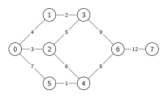
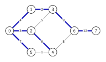
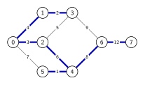
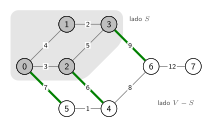
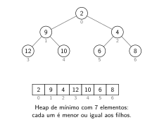
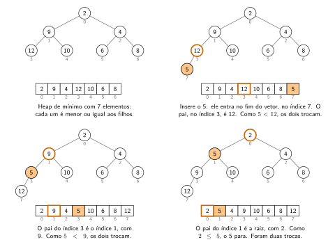
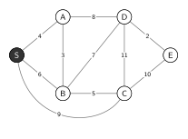

# Árvores geradoras mínimas

[Slides desta aula (PDF)](13/00_arvores_geradoras/arvores_geradoras.pdf)

## Bibliografia recomendada para o tema

* SEDGEWICK, R.; WAYNE, K. **Algorithms**, 4th ed., seção 4.3 (*Minimum
  Spanning Trees*);
* CORMEN, T. et al. **Introduction to Algorithms**, 3rd ed., cap. 23
  (*Minimum Spanning Trees*);
* [algs4 - Minimum Spanning Trees](https://algs4.cs.princeton.edu/43mst/) e os
  [slides de Sedgewick e Wayne](https://algs4.cs.princeton.edu/lectures/keynote/43MinimumSpanningTrees.pdf),
  com as aplicações citadas na seção 8;
* visualizações interativas da USF para o
  [algoritmo de Kruskal](https://www.cs.usfca.edu/~galles/visualization/Kruskal.html)
  e o [algoritmo de Prim](https://www.cs.usfca.edu/~galles/visualization/Prim.html);
* documentação do pacote [`container/heap`](https://pkg.go.dev/container/heap);
* [metas do ODS 9](https://brasil.un.org/pt-br/sdgs/9), Indústria, Inovação e
  Infraestrutura.

## Objetivos da aula

Ao final desta aula você deve ser capaz de:

1. Definir árvore geradora e árvore geradora mínima de um grafo com pesos;
2. Enunciar a propriedade do corte e usá-la para justificar que uma aresta
   pertence à árvore geradora mínima;
3. Executar à mão os algoritmos de Kruskal e de Prim, registrando a ordem em que
   as arestas entram na árvore e as que são descartadas;
4. Explicar o papel do Union-Find no algoritmo de Kruskal e o da fila de
   prioridade no algoritmo de Prim, e o custo de cada um;
5. Discutir o que a árvore geradora mínima modela bem num projeto de
   infraestrutura, e o que ela deixa de fora.

Este conteúdo cai na Prova 2.

## 1. Fibra óptica para escolas rurais

Um município fictício precisa levar internet por fibra óptica a onze escolas
rurais, A a K. A sede, S, já tem conexão. O programa `escolas.go`
([ver no GitHub](https://github.com/tads-ufpr-alexkutzke/ds143-material/blob/main/src/13/demo/escolas.go))
compara duas redes que ligam todas as escolas à sede:

```bash
cd 13/demo
go run escolas.go
```

```
Tudo ligado à sede                  Árvore geradora mínima
|            K             .G   |   |           .K....       ...G   |
|   A.        .      F   ..     |   |   A..   ..      ...F...       |
|     ...B.   .     . ...       |   |      ..B.                     |
|        ....  .  ....          |   |          ..                   |
|           .... ...            |   |            ..                 |
|             ..S...            |   |              .S...            |
|        ....... .......H       |   |              .    ....H       |
|     C....   .  .    ...       |   |     C.      .          ..     |
|   ....     .    .      ....   |   |   ..  ...  .             ..   |
| D.        E     .          .I |   | D.       .E...             .I |
|                  J            |   |               ...J            |
11 ligações, 129.8 km               11 ligações, 81.6 km

66 ligações possíveis entre 12 locais.
A árvore usa 63% do cabo da rede ligada à sede.
```

No mapa, cada coluna vale 1 km e cada linha, 2 km, e os pontos marcam o trajeto
de cada cabo. As duas redes têm 11 ligações e levam a conexão a todas as
escolas. A da esquerda puxa um cabo da sede até cada escola. A da direita
aproveita as escolas já conectadas: B recebe o cabo de S e o repassa para A e
K, e K o repassa para F. O resultado usa 48 km de cabo a menos.

A rede da direita é a **árvore geradora mínima** do grafo em que os vértices
são os doze locais e há uma aresta entre cada par de locais, com a distância
como peso. Esta aula trata de como encontrá-la. A seção 8 volta a este
programa, para discutir o que essa rede deixa de fora.

<details>
<summary>Código completo de <code>escolas.go</code></summary>

```go
{{#include 13/demo/escolas.go}}
```
</details>

## 2. Grafos com pesos

Num **grafo com pesos** (*edge-weighted graph*), cada aresta tem um número
associado: distância, custo, tempo de viagem. O grafo $G$ da aula de
representação e percursos, agora com pesos, é o exemplo desta aula:



Os pesos podem ser quaisquer números, inclusive negativos ou repetidos. Os de
$G$ são inteiros distintos para facilitar as contas à mão.

Com pesos, a lista de adjacência passa a guardar a aresta inteira, e não só o
vizinho:

```go
type Aresta struct {
    V, W int
    Peso float64
}

// Outro devolve o extremo da aresta que não é v.
func (a Aresta) Outro(v int) int {
    if v == a.V {
        return a.W
    }
    return a.V
}

type GrafoP struct {
    adj [][]Aresta
}

// A aresta v-w entra na lista de v e na lista de w.
func (g *GrafoP) AdicionaAresta(a Aresta) {
    g.adj[a.V] = append(g.adj[a.V], a)
    g.adj[a.W] = append(g.adj[a.W], a)
}
```

O método `Outro` existe porque a mesma aresta aparece nas duas listas: na
lista de 4, a aresta 4-5 leva ao 5; na lista de 5, ela leva ao 4. A
representação é a do Sedgewick, que chama o tipo de `Edge` e o método de
`other`.

## 3. Árvore geradora mínima

Uma **árvore geradora** (*spanning tree*) de um grafo conexo é um subconjunto
das arestas que liga todos os vértices e não tem ciclo. Como toda árvore com
$V$ vértices, ela tem $V - 1$ arestas.

A árvore da busca em largura é uma árvore geradora. A de $G$ a partir de 0, vista
na aula anterior, tem peso $4 + 3 + 7 + 2 + 6 + 9 + 12 = 43$:



A **árvore geradora mínima** (AGM, *minimum spanning tree*, MST) é a árvore
geradora de menor peso total. A de $G$ tem peso 36:



Testar todas as árvores geradoras e escolher a mais leve não funciona. $G$, com
8 vértices e 10 arestas, tem 50 árvores geradoras. Num grafo completo com $n$
vértices, há $n^{n-2}$ árvores geradoras (fórmula de Cayley): o grafo das 12
localidades da seção 1 tem $12^{10}$, cerca de 62 bilhões. Os algoritmos desta
aula encontram a árvore mínima em tempo $O(E \log E)$.

Quando os pesos são todos distintos, a árvore geradora mínima é única. Com
pesos repetidos pode haver mais de uma, todas com o mesmo peso total. As
justificativas desta aula supõem pesos distintos; os algoritmos funcionam nos
dois casos.

A árvore geradora mínima só existe em grafo conexo. Num grafo desconexo, o
equivalente é a **floresta geradora mínima**, com uma árvore mínima por
componente. A seção 7 mostra qual dos dois algoritmos a encontra.

## 4. A propriedade do corte

Um **corte** (*cut*) de um grafo divide os vértices em dois conjuntos não
vazios. Uma **aresta de travessia** (*crossing edge*) liga um vértice de um
conjunto a um vértice do outro.



No corte da figura, \{0, 1, 2, 3\} de um lado e \{4, 5, 6, 7\} do outro, as
arestas de travessia são 0-5 (peso 7), 2-4 (peso 6) e 3-6 (peso 9).

> **Propriedade do corte.** Em qualquer corte, a aresta de travessia de menor
> peso pertence à árvore geradora mínima.

No exemplo, a aresta 2-4 está na árvore mínima. A justificativa é uma troca.
Seja $e$ a aresta de travessia mais leve, e suponha uma árvore mínima $T$ que
não contém $e$:

1. acrescentar $e$ a $T$ fecha um ciclo, porque $T$ já liga os dois extremos de
   $e$;
2. esse ciclo atravessa o corte por $e$ e precisa voltar para o lado de onde
   saiu: alguma outra aresta $f$ do ciclo também é de travessia;
3. retirar $f$ e acrescentar $e$ dá outra árvore geradora, porque o ciclo se
   desfaz e todos os vértices continuam ligados;
4. $e$ pesa menos que $f$, então a árvore nova pesa menos que $T$.

Isso contradiz a suposição de que $T$ era mínima. No exemplo: uma árvore
geradora sem 2-4 precisa atravessar o corte por 0-5 ou por 3-6, e trocar essa
aresta por 2-4 diminui o peso.

A propriedade do corte leva a um **algoritmo guloso**:

1. comece sem nenhuma aresta;
2. escolha um corte que nenhuma das arestas já escolhidas atravessa;
3. acrescente a aresta de travessia mais leve desse corte;
4. repita até ter $V - 1$ arestas.

Cada aresta acrescentada pertence à árvore mínima, pela propriedade do corte.
Enquanto houver menos de $V - 1$ arestas escolhidas, elas formam mais de uma
componente, e o corte entre uma dessas componentes e o resto não é atravessado
por nenhuma delas: o passo 2 sempre tem um corte disponível. Os algoritmos de
Kruskal e de Prim são duas formas de escolher o corte a cada passo.

## 5. Algoritmo de Kruskal

O algoritmo de Kruskal examina as arestas da mais leve para a mais pesada. Cada
aresta entra na árvore se não fechar um ciclo com as que já entraram:

1. ordene as arestas por peso, da mais leve para a mais pesada;
2. examine cada aresta $v$-$w$ nessa ordem: se $v$ e $w$ já estão ligados pelas
   arestas escolhidas, a aresta fecharia um ciclo e é descartada; se não, ela
   entra;
3. pare quando a árvore tiver $V - 1$ arestas.

Durante a execução, as arestas escolhidas formam uma floresta, que só vira
árvore no fim. A pergunta "$v$ e $w$ já estão ligados?" é a que o
**Union-Find**, a primeira estrutura do semestre, responde: cada árvore da
floresta é uma componente, `Connected` testa se dois vértices estão na mesma
componente e `Union` junta duas componentes quando uma aresta entra.

```go
func Kruskal(n int, arestas []Aresta) []Aresta {
    // Ordena uma cópia, para não alterar a lista de quem chamou.
    ordem := make([]Aresta, len(arestas))
    copy(ordem, arestas)
    sort.Slice(ordem, func(i, j int) bool {
        return ordem[i].Peso < ordem[j].Peso
    })

    uf := NovoUF(n)
    var arvore []Aresta
    for _, a := range ordem {
        if len(arvore) == n-1 {
            break // a árvore já tem V-1 arestas
        }
        if uf.Connected(a.V, a.W) {
            continue // fecharia um ciclo
        }
        uf.Union(a.V, a.W)
        arvore = append(arvore, a)
    }
    return arvore
}
```

O Union-Find de `kruskal.go` é o de união por tamanho (*weighted quick-union*),
o mesmo do material de análise de algoritmos, com os nomes traduzidos.

Por que o Kruskal está correto: quando a aresta $v$-$w$ entra, considere o
corte entre a componente de $v$ e o resto do grafo. Nenhuma aresta escolhida
atravessa esse corte, e nenhuma aresta de travessia mais leve que $v$-$w$
existe, porque todas as mais leves já foram examinadas e cada uma delas entrou
ou ligava vértices de uma mesma componente. Então $v$-$w$ é a aresta de
travessia mais leve desse corte.

### Execução em $G$

O programa `kruskal.go`
([ver no GitHub](https://github.com/tads-ufpr-alexkutzke/ds143-material/blob/main/src/13/codes/kruskal.go))
imprime cada aresta examinada:

```
$ go run kruskal.go
Kruskal: arestas da mais leve para a mais pesada
  4-5     1   entra
  1-3     2   entra
  0-2     3   entra
  0-1     4   entra
  2-3     5   descarta: 2 e 3 já estão ligados
  2-4     6   entra
  0-5     7   descarta: 0 e 5 já estão ligados
  4-6     8   entra
  3-6     9   descarta: 3 e 6 já estão ligados
  6-7    12   entra

Árvore geradora mínima: 4-5 1-3 0-2 0-1 2-4 4-6 6-7
7 arestas, peso total 36
```

As componentes do Union-Find depois de cada aresta:

| Aresta | Peso | Situação | Componentes |
|---|---|---|---|
| | | | \{0\} \{1\} \{2\} \{3\} \{4\} \{5\} \{6\} \{7\} |
| 4-5 | 1 | entra | \{0\} \{1\} \{2\} \{3\} \{4 5\} \{6\} \{7\} |
| 1-3 | 2 | entra | \{0\} \{1 3\} \{2\} \{4 5\} \{6\} \{7\} |
| 0-2 | 3 | entra | \{0 2\} \{1 3\} \{4 5\} \{6\} \{7\} |
| 0-1 | 4 | entra | \{0 1 2 3\} \{4 5\} \{6\} \{7\} |
| 2-3 | 5 | descarta | \{0 1 2 3\} \{4 5\} \{6\} \{7\} |
| 2-4 | 6 | entra | \{0 1 2 3 4 5\} \{6\} \{7\} |
| 0-5 | 7 | descarta | \{0 1 2 3 4 5\} \{6\} \{7\} |
| 4-6 | 8 | entra | \{0 1 2 3 4 5 6\} \{7\} |
| 3-6 | 9 | descarta | \{0 1 2 3 4 5 6\} \{7\} |
| 6-7 | 12 | entra | \{0 1 2 3 4 5 6 7\} |

A aresta 2-3 é descartada porque 2 e 3 já estão ligados pelo caminho 2, 0, 1,
3. A aresta 6-7 é a mais pesada do grafo e entra mesmo assim: ela é a única
ligação do 7 com o resto, e toda árvore geradora precisa dela. Aqui a última
aresta da lista completa a árvore; em outros grafos, o laço termina antes, ao
chegar a $V - 1$ arestas.

### Custo

Ordenar as arestas custa $O(E \log E)$. Depois, cada aresta faz no máximo uma
chamada a `Connected` e uma a `Union`, e cada uma custa $O(\log V)$ com a união
por tamanho. O total é $O(E \log E)$, dominado pela ordenação.

## 6. Algoritmo de Prim

O algoritmo de Prim faz crescer uma única árvore a partir de um vértice $s$:

1. comece a árvore com o vértice $s$;
2. acrescente a aresta mais leve que liga um vértice da árvore a um vértice fora
   dela, e esse vértice;
3. repita até a árvore ter todos os vértices.

O corte de cada passo é \{vértices da árvore\} de um lado e \{os demais\} do
outro. Nenhuma aresta escolhida o atravessa, e a aresta escolhida é a de
travessia mais leve: o algoritmo de Prim é o algoritmo guloso da seção 4 com
essa escolha de corte.

### Fila de prioridade

Para achar a aresta mais leve sem percorrer todas a cada passo, as arestas
candidatas ficam numa **fila de prioridade** (*priority queue*): uma estrutura
em que se insere em qualquer ordem e se retira sempre o menor elemento. A
implementação mais usada é o heap binário.

#### Heap de mínimo

Um **heap de mínimo** (*min-heap*) é uma árvore binária com duas propriedades:

- é **completa**: todos os níveis estão cheios, menos talvez o último, que é
  preenchido da esquerda para a direita;
- cada elemento é **menor ou igual aos seus filhos**. Por isso o menor de todos
  está na raiz.

Ao contrário da árvore binária de busca, o heap não ordena os irmãos: o filho
da esquerda pode ser maior ou menor que o da direita. A única garantia é a do
pai em relação aos filhos.

Por ser completa, a árvore cabe num vetor, sem ponteiros. Os elementos ficam
nível por nível, da esquerda para a direita, e as posições se calculam:

- os filhos do índice $i$ estão em $2i + 1$ e $2i + 2$;
- o pai do índice $i$ está em $(i - 1) / 2$, com divisão inteira.



No exemplo, os filhos do 9 (índice 1) estão nos índices 3 e 4, e o pai do 6
(índice 5) está no índice 2. Uma árvore completa com $n$ elementos tem altura
$\lfloor \log_2 n \rfloor$, e as duas operações abaixo percorrem no máximo um
caminho da raiz até uma folha: as duas custam $O(\log n)$.

#### Inserção: o novo elemento sobe

O novo elemento entra no fim do vetor, que é a primeira posição livre do último
nível. Ali ele pode ser menor que o pai e violar a segunda propriedade. Enquanto
for menor que o pai, os dois trocam de lugar, e o elemento sobe um nível.



#### Retirada do mínimo: o último elemento desce

O menor elemento está na raiz. Para retirá-lo sem deixar um buraco na árvore, o
último elemento do vetor vai para a raiz e o vetor encolhe uma posição. A raiz
nova pode ser maior que os filhos. Enquanto for maior que o menor dos filhos,
os dois trocam de lugar, e o elemento desce um nível. A troca é com o **menor**
dos filhos: trocar com o maior poria o maior acima do menor, e a propriedade
continuaria violada.


#### Heap de mínimo em Go

O programa `heap.go`
([ver no GitHub](https://github.com/tads-ufpr-alexkutzke/ds143-material/blob/main/src/13/codes/heap.go))
implementa o heap de mínimo de inteiros e repete o exemplo das figuras.

```go
type HeapMin struct {
    v []int
}

func (h *HeapMin) Insere(x int) {
    h.v = append(h.v, x)
    h.sobe(len(h.v) - 1)
}

func (h *HeapMin) RetiraMin() int {
    menor := h.v[0]
    ultimo := len(h.v) - 1
    h.v[0] = h.v[ultimo]
    h.v = h.v[:ultimo]
    if len(h.v) > 0 {
        h.desce(0)
    }
    return menor
}

// sobe troca o elemento do índice i com o pai enquanto ele for menor que o pai.
func (h *HeapMin) sobe(i int) {
    for i > 0 {
        pai := (i - 1) / 2
        if h.v[pai] <= h.v[i] {
            return
        }
        h.v[pai], h.v[i] = h.v[i], h.v[pai]
        i = pai
    }
}

// desce troca o elemento do índice i com o menor dos filhos enquanto esse
// filho for menor que ele.
func (h *HeapMin) desce(i int) {
    n := len(h.v)
    for {
        menor := i
        esq, dir := 2*i+1, 2*i+2
        if esq < n && h.v[esq] < h.v[menor] {
            menor = esq
        }
        if dir < n && h.v[dir] < h.v[menor] {
            menor = dir
        }
        if menor == i {
            return // nenhum filho é menor: o elemento está no lugar
        }
        h.v[menor], h.v[i] = h.v[i], h.v[menor]
        i = menor
    }
}
```

```
$ go run heap.go
heap inicial:   [2 9 4 12 10 6 8]
insere 5:       [2 5 4 9 10 6 8 12]
retira o menor: 2
heap:           [4 5 6 9 10 12 8]
retira todos:   4 5 6 8 9 10 12
```

O vetor do heap não fica ordenado: depois da retirada, o 8 está no fim, atrás
do 12. Mesmo assim, retirar o menor repetidas vezes devolve os elementos em
ordem crescente, e essa é a ideia do *heapsort*. Na fila do Prim, os elementos
são arestas, e a comparação `<` entre inteiros dá lugar à comparação entre os
pesos.

#### O pacote `container/heap`

Go tem o heap binário no pacote `container/heap`, que faz o sobe e o desce. O
pacote não guarda os dados: ele organiza um tipo seu que implemente cinco
métodos.

```go
type FilaArestas []Aresta

func (f FilaArestas) Len() int           { return len(f) }
func (f FilaArestas) Less(i, j int) bool { return f[i].Peso < f[j].Peso }
func (f FilaArestas) Swap(i, j int)      { f[i], f[j] = f[j], f[i] }
func (f *FilaArestas) Push(x any)        { *f = append(*f, x.(Aresta)) }
func (f *FilaArestas) Pop() any {
    antigo := *f
    n := len(antigo)
    a := antigo[n-1]
    *f = antigo[:n-1]
    return a
}
```

`Less` define a ordem: aqui, a menor aresta sai primeiro. `Push` e `Pop`
apenas acrescentam e retiram do fim do *slice*. O programa nunca os chama
diretamente: usa `heap.Push(fila, a)` e `heap.Pop(fila)`, que chamam esses
métodos e reorganizam o heap em $O(\log n)$.

O Trabalho Prático proíbe `container/*`. Se o seu bot precisar de uma fila de
prioridade, o heap tem de ser escrito à mão.

### O algoritmo

```go
func Prim(g *GrafoP, s int) []Aresta {
    naArvore := make([]bool, g.V())
    fila := &FilaArestas{}
    var arvore []Aresta

    // visita põe v na árvore e as arestas de v para fora dela na fila.
    visita := func(v int) {
        naArvore[v] = true
        for _, a := range g.adj[v] {
            if !naArvore[a.Outro(v)] {
                heap.Push(fila, a)
            }
        }
    }

    visita(s)
    for fila.Len() > 0 && len(arvore) < g.V()-1 {
        a := heap.Pop(fila).(Aresta)
        if naArvore[a.V] && naArvore[a.W] {
            continue // os dois extremos já estão na árvore
        }
        arvore = append(arvore, a)
        novo := a.V
        if naArvore[a.V] {
            novo = a.W
        }
        visita(novo)
    }
    return arvore
}
```

Uma aresta entra na fila quando um dos extremos entra na árvore. Até ela sair
da fila, o outro extremo pode ter entrado na árvore por outra aresta mais leve.
Nesse caso ela deixou de ser de travessia: sai da fila e é descartada. Esta é a
versão **preguiçosa** (*lazy*) do algoritmo de Prim, que deixa as arestas
inúteis na fila em vez de retirá-las na hora.

### Execução em $G$, a partir de 0

O programa `prim.go`
([ver no GitHub](https://github.com/tads-ufpr-alexkutzke/ds143-material/blob/main/src/13/codes/prim.go))
imprime a fila depois de cada aresta retirada. O *slice* do heap não fica
ordenado; o programa imprime uma cópia ordenada por peso, para facilitar a
leitura.

```
$ go run prim.go
Prim a partir de 0
  início            fila: 0-2(3) 0-1(4) 0-5(7)
  0-2  3 entra 2    fila: 0-1(4) 2-3(5) 2-4(6) 0-5(7)
  0-1  4 entra 1    fila: 1-3(2) 2-3(5) 2-4(6) 0-5(7)
  1-3  2 entra 3    fila: 2-3(5) 2-4(6) 0-5(7) 3-6(9)
  2-3  5 descarta   fila: 2-4(6) 0-5(7) 3-6(9)
  2-4  6 entra 4    fila: 4-5(1) 0-5(7) 4-6(8) 3-6(9)
  4-5  1 entra 5    fila: 0-5(7) 4-6(8) 3-6(9)
  0-5  7 descarta   fila: 4-6(8) 3-6(9)
  4-6  8 entra 6    fila: 3-6(9) 6-7(12)
  3-6  9 descarta   fila: 6-7(12)
  6-7 12 entra 7    fila:

Árvore geradora mínima: 0-2 0-1 1-3 2-4 4-5 4-6 6-7
7 arestas, peso total 36
```

A árvore é a mesma do Kruskal, porque os pesos são distintos, mas as arestas
entram em outra ordem. A aresta 4-5, a mais leve do grafo, é a primeira no
Kruskal e a quinta no Prim: ela só fica disponível quando o 4 entra na árvore.
A aresta 2-3 entra na fila quando o 2 entra na árvore; quando ela sai, o 3 já
entrou pela aresta 1-3, e ela é descartada.

### Custo

Cada aresta entra na fila no máximo uma vez, quando o primeiro dos seus
extremos entra na árvore, e sai no máximo uma vez. A fila chega a ter até $E$
arestas, e cada operação custa $O(\log E)$. O total é $O(E \log E)$, com
$O(E)$ de memória para a fila.

A versão **ansiosa** (*eager*) guarda na fila um vértice por vez, com a aresta
mais leve conhecida que o liga à árvore, e atualiza essa aresta quando aparece
uma melhor. A fila tem no máximo $V$ itens e o custo cai para $O(E \log V)$,
mas a fila precisa de uma operação a mais, a de diminuir a prioridade de um
item, que o Sedgewick implementa como fila de prioridade indexada. Em grafo
denso, um vetor simples no lugar da fila, percorrido inteiro a cada passo, dá
$O(V^2)$ sem heap nenhum.

### Prim e Dijkstra

O algoritmo de Dijkstra, assunto da aula de caminhos mínimos, tem a estrutura
do Prim: uma árvore que cresce a partir de $s$, um vértice por vez, com as
arestas candidatas numa fila de prioridade. Muda a prioridade. O Prim escolhe a
aresta mais leve que sai da árvore, e a prioridade é o peso da aresta. O
Dijkstra escolhe o vértice de fora mais próximo da origem, e a prioridade de
uma aresta v-w, com v na árvore, é a distância de $s$ até v somada ao peso da
aresta. O resultado é a árvore de caminhos mínimos a partir de $s$, que pode
ser diferente da árvore geradora mínima. Em $G$, a partir de 0, as duas já
diferem no vértice 5: a árvore mínima chega a ele por 0-2-4-5, com peso 10, e o
caminho mínimo é a aresta 0-5, com peso 7.

## 7. Kruskal ou Prim

| | Kruskal | Prim |
|---|---|---|
| O que cresce | uma floresta, que vira árvore no fim | uma árvore, a partir de $s$ |
| Estrutura auxiliar | ordenação e Union-Find | fila de prioridade |
| Custo | $O(E \log E)$ | $O(E \log E)$; $O(E \log V)$ na versão ansiosa |
| Grafo desconexo | encontra a floresta geradora mínima | encontra a árvore da componente de $s$ |

Como um grafo sem arestas paralelas tem $E < V^2$, vale $\log E < 2 \log V$:
$O(E \log E)$ e $O(E \log V)$ diferem por uma constante. Na prática, a escolha
depende mais da forma como o grafo chega ao programa. Se as arestas chegam numa
lista, o Kruskal não precisa montar as listas de adjacência. Se o grafo é denso
e já está em matriz, o Prim com vetor faz $O(V^2)$.

## 8. Árvores geradoras e infraestrutura

### Origem do problema

O primeiro algoritmo para a árvore geradora mínima foi publicado em 1926 por
Otakar Borůvka, para projetar a rede elétrica da Morávia, na atual República
Tcheca, com o menor comprimento de linhas. Vojtěch Jarník publicou em 1930 o
algoritmo que hoje leva o nome de Prim. Joseph Kruskal publicou o seu em 1956,
e Robert Prim redescobriu o de Jarník em 1957, nos Bell Labs, ao tratar de
redes telefônicas. Edsger Dijkstra o redescobriu de novo em 1959.

O problema nasceu como problema de infraestrutura, e é o tema do **ODS 9**
(Indústria, Inovação e Infraestrutura) da Agenda 2030. Duas metas tocam no
exemplo da seção 1:

* **9.1**: desenvolver infraestrutura de qualidade, confiável, sustentável e
  resiliente, com foco no acesso equitativo e a preços acessíveis para todos;
* **9.c**: aumentar significativamente o acesso às tecnologias de informação e
  comunicação e oferecer acesso universal e a preços acessíveis à internet.

### Atividade em sala: a rede das escolas

A sede S de outro município fictício já tem conexão, e as escolas A a E
precisam ser ligadas a ela. O mapa mostra as ligações possíveis, com o custo
de cada uma em km de cabo:



Em dupla:

1. Execute o algoritmo de Kruskal à mão: liste as arestas na ordem em que são
   examinadas, marque as que entram e as que são descartadas, e calcule o custo
   total da rede.
2. Na rede encontrada, qual ligação, se for cortada, deixa mais escolas sem
   conexão com a sede? Quantas?
3. Acrescente à rede uma única ligação, a mais barata possível, de modo que
   nenhum corte isole mais de duas escolas.
4. Quais ligações é preciso acrescentar para que nenhum corte isole escola
   alguma? Qual o custo total da rede?

As respostas são discutidas em sala e estão nos slides.

### O que o modelo deixa de fora

A árvore geradora mínima responde a uma pergunta precisa: qual o menor
comprimento de cabo que liga todos os pontos, usando só as ligações da lista. O
projeto real de uma rede tem outras exigências.

**Resiliência.** Numa árvore, toda aresta é uma **ponte**: retirada, desconecta
o grafo. A última coluna da saída de `escolas.go` mostra quem fica sem conexão
quando cada ligação é cortada:

```
Ligações da árvore e escolas isoladas da sede se a ligação for cortada:
  A-B   5.4 km   A
  B-K   5.7 km   F G K
  C-D   5.7 km   D
  C-E   7.2 km   C D
  E-J   7.3 km   J
  F-G   7.3 km   G
  F-K   8.2 km   F G
  S-H   8.2 km   H I
  H-I   8.5 km   I
  S-E   8.9 km   C D E J
  S-B   9.2 km   A B F G K
```

Um cabo rompido na ligação S-B deixa cinco escolas sem internet. A meta 9.1
pede infraestrutura resiliente, e a redundância custa caro: na atividade, a rede
sem pontes custa bem mais que a árvore. Encontrar a rede mais barata sem pontes
é um problema bem mais difícil que o da árvore geradora mínima, e a solução não
precisa conter a árvore mínima.

**Pontos de junção.** Três escolas nos vértices de um triângulo equilátero de 10
km de lado são ligadas pela árvore mínima com 20 km de cabo. Uma caixa de
emenda no centro do triângulo, ligada às três, usa $3 \times 10/\sqrt{3}
\approx 17{,}3$ km. Acrescentar pontos que não estavam no grafo pode baratear a
rede, e escolher esses pontos é o **problema da árvore de Steiner**, que é
NP-difícil.

**Custo real.** O peso de `escolas.go` é a distância em linha reta. No projeto
real, o cabo segue estradas e postes, atravessa rios e depende de licenças. O
peso de cada aresta é uma decisão de modelagem, e o algoritmo devolve a melhor
árvore para os pesos que recebeu.

**Quem entra no grafo.** A árvore liga todos os vértices do grafo. Quais
escolas entram no projeto é uma decisão anterior ao algoritmo.

### Outras aplicações

A lista abaixo segue a dos slides de Sedgewick e Wayne, com acréscimos da
literatura citada por eles:

| Aplicação | O que a árvore representa |
|---|---|
| Projeto de redes | redes elétricas, telefônicas, de dados, de água e viárias de menor custo |
| Agrupamento (*single-link clustering*) | retirar as $k - 1$ arestas mais pesadas da árvore deixa $k$ grupos de pontos próximos entre si |
| Segmentação de imagens | pixels como vértices e diferença de cor como peso; os grupos são as regiões da imagem |
| Caixeiro-viajante | percorrer a árvore dá uma rota no máximo duas vezes mais longa que a ótima, quando os pesos obedecem à desigualdade triangular |
| Taxonomia e biologia | árvores de semelhança entre espécies, genes ou tumores |
| Redes Ethernet | o protocolo *Spanning Tree* (STP) desliga ligações entre *switches* até sobrar uma árvore geradora, o que elimina os ciclos de encaminhamento |

No último caso, a árvore é escolhida pela distância de cada *switch* até um
*switch* raiz, e não pelo peso total: o STP calcula uma árvore geradora, mas não
necessariamente a mínima.

## 9. Exercícios

**Estes exercícios não valem nota** e não têm entrega. O conteúdo cai na Prova 2.
Os exercícios 1 a 3 usam o grafo com 7 vértices e as arestas, com seus pesos:

```
0-1 7   0-3 4   1-2 9   1-3 8   1-4 6   2-4 5
3-4 13  3-5 3   4-5 11  4-6 10  5-6 12
```

**1.** Desenhe o grafo e execute à mão o algoritmo de Kruskal: liste as arestas
na ordem em que são examinadas, marque as que entram e as que são descartadas,
e registre as componentes depois de cada aresta. Qual é o peso da árvore?
Confira com o `kruskal.go`, trocando no `main` a lista de arestas e o número de
vértices.

**2.** Execute à mão o algoritmo de Prim a partir de 0, na versão preguiçosa.
Registre o conteúdo da fila depois de cada aresta retirada. Quais arestas são
descartadas? Confira com o `prim.go`.

**3.** No grafo dos exercícios 1 e 2, considere o corte \{0, 1, 2\} e \{3, 4,
5, 6\}. Liste as arestas de travessia. Qual delas a propriedade do corte coloca
na árvore mínima? Confira com a resposta do exercício 1.

**4.** Diga se cada afirmação é verdadeira ou falsa, e justifique com um
argumento ou com um contraexemplo. Suponha pesos distintos.

* (a) A aresta mais pesada do grafo nunca está na árvore geradora mínima.
* (b) A aresta mais leve do grafo sempre está na árvore geradora mínima.
* (c) Somar 5 ao peso de todas as arestas não muda a árvore geradora mínima.
* (d) Elevar ao quadrado o peso de todas as arestas não muda a árvore geradora
  mínima.
* (e) O caminho entre dois vértices na árvore geradora mínima é o caminho de
  menor peso entre eles no grafo.

**5.** Retire de $G$ a aresta 6-7 e acrescente o vértice 8 e a aresta 7-8, com
peso 2. O grafo passa a ter duas componentes. O que `kruskal.go` devolve? E
`prim.go`, a partir de 0? Explique a diferença pelo modo como cada algoritmo
cresce.

**6.** Como encontrar a **árvore geradora máxima**, a de maior peso total, com
o código de `kruskal.go`? Dê duas formas.

**7.** No `escolas.go`, divida as escolas e a sede em três regiões de
atendimento: retire da árvore as duas ligações mais longas e liste os locais de
cada componente que sobra. Quais são as regiões? Essa é a ideia do agrupamento
da tabela da seção 8.

**8.** Na execução de Prim em $G$, qual o maior tamanho que a fila atinge? Num
grafo completo com $V$ vértices, quantas arestas a fila pode ter, no máximo,
na versão preguiçosa?

### Desafio

Escreva a versão do algoritmo de Prim para grafos densos, sem fila de
prioridade: guarde o grafo numa matriz de pesos e mantenha um vetor
`melhor[v]` com o peso da aresta mais leve que liga $v$ à árvore. A cada passo,
percorra o vetor para escolher o próximo vértice e atualize `melhor` com as
arestas dele. Teste com $G$ e com o grafo dos exercícios 1 a 3, e explique por
que o custo é $O(V^2)$.

---

## Resumo

* Uma árvore geradora liga todos os vértices de um grafo conexo sem formar
  ciclo, e tem $V - 1$ arestas. A árvore geradora mínima é a de menor peso
  total, e é única quando os pesos são distintos.
* Propriedade do corte: em qualquer corte, a aresta de travessia mais leve está
  na árvore mínima. Kruskal e Prim aplicam essa propriedade com escolhas
  diferentes de corte.
* O algoritmo de Kruskal examina as arestas em ordem crescente de peso e usa o
  Union-Find para descartar as que fechariam um ciclo. Custo $O(E \log E)$.
* O algoritmo de Prim cresce uma árvore a partir de um vértice, sempre pela
  aresta mais leve que sai dela, guardada numa fila de prioridade. Custo
  $O(E \log E)$ na versão preguiçosa, $O(E \log V)$ na ansiosa.
* O heap de mínimo é uma árvore binária completa, guardada num vetor, em que
  cada elemento é menor ou igual aos filhos. Na inserção, o novo elemento sobe;
  na retirada do mínimo, o último elemento vai para a raiz e desce. As duas
  operações custam $O(\log n)$.
* A árvore geradora mínima modela a rede de menor custo, sem redundância: cada
  aresta é uma ponte. Resiliência, pontos de junção e custos reais ficam fora
  do modelo.
