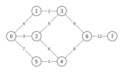
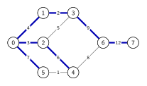
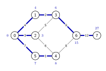
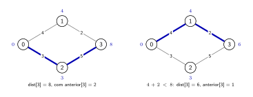
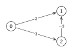
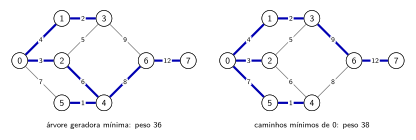

# Caminhos mínimos

[Slides desta aula (PDF)](14/00_caminhos_minimos/caminhos_minimos.pdf)

## Bibliografia recomendada para o tema

* SEDGEWICK, R.; WAYNE, K. **Algorithms**, 4th ed., seção 4.4 (*Shortest
  Paths*);
* CORMEN, T. et al. **Introduction to Algorithms**, 3rd ed., cap. 24
  (*Single-Source Shortest Paths*);
* [algs4 - Shortest Paths](https://algs4.cs.princeton.edu/44sp/) e os
  [slides de Sedgewick e Wayne](https://algs4.cs.princeton.edu/lectures/keynote/44ShortestPaths.pdf);
* [visualização interativa da USF](https://www.cs.usfca.edu/~galles/visualization/Dijkstra.html)
  para o algoritmo de Dijkstra.

## Objetivos da aula

Ao final desta aula você deve ser capaz de:

1. Definir caminho mínimo e distância em um grafo com pesos, e mostrar com um
   exemplo por que a busca em largura não os encontra;
2. Executar à mão o algoritmo de Dijkstra, registrando as distâncias, a fila de
   prioridade e os candidatos descartados;
3. Explicar a relaxação de uma aresta e por que o algoritmo exige pesos não
   negativos;
4. Justificar o custo do algoritmo;
5. Diferenciar a árvore de caminhos mínimos da árvore geradora mínima.

Este conteúdo cai na Prova 2. A parte teórica é curta, porque o restante do
encontro é dedicado à Atividade Avaliativa 4.

## 1. Rotas da sede até as escolas

O município da aula de árvores geradoras mínimas tem 21 estradas entre a sede,
S, e as escolas, A a K. Cada estrada é uma aresta, e o comprimento dela é o
peso. O programa `rotas.go`
([ver no GitHub](https://github.com/tads-ufpr-alexkutzke/ds143-material/blob/main/src/14/demo/rotas.go))
responde a duas perguntas sobre essas estradas: qual o menor conjunto de
estradas que liga todos os locais, e qual a rota mais curta da sede até cada
escola.

```bash
cd 14/demo
go run rotas.go
```

```
Árvore geradora mínima              Árvore de caminhos mínimos, de S
|           .K....       ...G   |   |            K           ...G   |
|   A..   ..      ...F...       |   |   A..       .      F...       |
|      ..B.                     |   |      ..B.   .     .           |
|          ..                   |   |          ..  .  ..            |
|            ..                 |   |            ... .              |
|              .S...            |   |              .S...            |
|              .    ....H       |   |              . .  ....H       |
|     C.      .          ..     |   |     C.      .  .       ..     |
|   ..  ...  .             ..   |   |       ...  .    .        ..   |
| D.       .E...             .I |   | D.........E     .          .I |
|               ...J            |   |                  J            |
81.6 km de estrada                  95.1 km de estrada

Distância de S, entre 21 estradas:
  escola   pela árvore mínima   caminho mínimo
  A                   14.6 km          14.6 km
  B                    9.2 km           9.2 km
  C                   16.2 km          16.2 km
  D                   21.8 km          18.9 km
  E                    8.9 km           8.9 km
  F                   23.1 km           9.4 km
  G                   30.4 km          16.7 km
  H                    8.2 km           8.2 km
  I                   16.7 km          16.7 km
  J                   16.2 km          10.4 km
  K                   14.9 km          10.4 km
```

A árvore geradora mínima usa menos estrada no total, mas pode obrigar a um
caminho longo: de S até F, são 23,1 km por ela, e existe uma estrada direta de
9,4 km. A árvore da direita é a resposta da segunda pergunta, e o algoritmo que
a constrói é o assunto desta aula.

## 2. O problema do caminho mínimo

Em um grafo com pesos, o **peso de um caminho** é a soma dos pesos das suas
arestas. O **caminho mínimo** (*shortest path*) de $s$ a $v$ é um caminho de
menor peso entre todos os que ligam os dois vértices, e a **distância** de $s$
a $v$ é o peso desse caminho. Nesta aula, $s$ é uma origem fixa, e queremos a
distância de $s$ a todos os outros vértices.

O exemplo é o grafo $G$ da aula de árvores geradoras mínimas, com os mesmos
pesos:



Entre os caminhos de 0 a 6 estão 0-1-3-6, com peso 15, 0-5-4-6, com peso 16, e
0-2-4-6, com peso 17. Nenhum caminho pesa menos que 15, e essa é a distância de
0 a 6.

### A busca em largura não olha os pesos

A busca em largura encontra o caminho com menos arestas, e essa medida deixa de
ser a que interessa quando as arestas têm pesos diferentes. Na árvore da busca
em largura a partir de 0, o vértice 4 é alcançado por 0-2-4, com peso 9:



O caminho 0-5-4 também tem duas arestas e pesa 8. A busca em largura visita os
vértices por número de arestas desde a origem. Com pesos, o próximo vértice a
visitar precisa ser escolhido pela distância percorrida até ele.

### A árvore de caminhos mínimos

Um trecho inicial de um caminho mínimo também é um caminho mínimo. Se o caminho
mínimo de 0 a 6 passa por 1 e 3, o trecho 0-1-3 é o caminho mínimo de 0 a 3,
porque um caminho menor até 3 também encurtaria o caminho até 6. Por isso, os
caminhos mínimos a partir de $s$ podem ser representados por uma árvore
enraizada em $s$, a **árvore de caminhos mínimos**, em que basta guardar, para
cada vértice, o vértice anterior no caminho.



## 3. Relaxação

O algoritmo mantém dois vetores: `dist[w]`, o peso do melhor caminho conhecido
até $w$, e `anterior[w]`, o vértice que vem antes de $w$ nesse caminho. No
início, `dist[s]` é 0 e as outras distâncias são infinitas.

**Relaxar** a aresta v-w, a partir de $v$, é verificar se passar por $v$ melhora
o caminho conhecido até $w$:

```go
if dist[v]+a.Peso < dist[w] {
    dist[w] = dist[v] + a.Peso
    anterior[w] = v
}
```

Na figura, o melhor caminho conhecido até 3 passa por 2 e pesa 8. Relaxar a
aresta 1-3 encontra um caminho com peso $4 + 2 = 6$, e `dist[3]` e `anterior[3]`
mudam:



## 4. Algoritmo de Dijkstra

O algoritmo de Dijkstra faz crescer a árvore de caminhos mínimos a partir de
$s$, um vértice por vez. Uma fila de prioridade, implementada como heap de
mínimo, guarda os **candidatos**: um vértice e a distância do caminho encontrado
até ele.

1. Comece com `dist[s]` igual a 0, as outras distâncias infinitas e o candidato
   $s$ na fila;
2. Retire da fila o candidato de menor distância;
3. Se o vértice já está na árvore, descarte o candidato;
4. Senão, coloque o vértice na árvore e relaxe as arestas dele. Cada melhora põe
   um novo candidato na fila;
5. Repita até a fila esvaziar.

Um vértice pode ter vários candidatos na fila, um para cada melhora da sua
distância. Só o de menor distância coloca o vértice na árvore, e os outros são
descartados ao sair da fila.

### O código

```go
// Candidato é um vértice que pode entrar na árvore, com a distância da origem
// até ele pelo caminho encontrado até aqui.
type Candidato struct {
    V    int
    Dist float64
}

func Dijkstra(g *GrafoP, s int) (dist []float64, anterior []int) {
    dist = make([]float64, g.V())
    anterior = make([]int, g.V())
    for v := range dist {
        dist[v] = math.Inf(1) // ainda sem caminho
        anterior[v] = -1
    }
    naArvore := make([]bool, g.V())
    fila := &FilaCandidatos{}

    dist[s] = 0
    heap.Push(fila, Candidato{s, 0})
    for fila.Len() > 0 {
        c := heap.Pop(fila).(Candidato)
        v := c.V
        if naArvore[v] {
            continue // v já entrou por um caminho menor
        }
        naArvore[v] = true

        // Relaxa as arestas de v: passar por v melhora o caminho até w?
        for _, a := range g.adj[v] {
            w := a.Outro(v)
            if !naArvore[w] && dist[v]+a.Peso < dist[w] {
                dist[w] = dist[v] + a.Peso
                anterior[w] = v
                heap.Push(fila, Candidato{w, dist[w]})
            }
        }
    }
    return dist, anterior
}
```

`FilaCandidatos` implementa `heap.Interface` como a `FilaArestas` do Prim, com
`Dist` no lugar de `Peso` na comparação. Um vértice que a origem não alcança
termina com `dist` infinita e `anterior` igual a -1.

O caminho até um vértice sai do vetor `anterior`, seguido de trás para a frente
até chegar a -1:

```go
func Caminho(anterior []int, v int) []int {
    var caminho []int
    for x := v; x != -1; x = anterior[x] {
        caminho = append(caminho, x)
    }
    slices.Reverse(caminho)
    return caminho
}
```

### Execução em $G$, a partir de 0

O programa `dijkstra.go`
([ver no GitHub](https://github.com/tads-ufpr-alexkutzke/ds143-material/blob/main/src/14/codes/dijkstra.go))
imprime a fila depois de cada candidato retirado. A notação `3(8)` é o candidato
do vértice 3 com distância 8. Assim como em `prim.go`, o programa imprime uma
cópia ordenada da fila, para facilitar a leitura.

```
$ go run dijkstra.go
Dijkstra a partir de 0
  início         fila: 0(0)
  0(0) entra     fila: 2(3) 1(4) 5(7)
  2(3) entra     fila: 1(4) 5(7) 3(8) 4(9)
  1(4) entra     fila: 3(6) 5(7) 3(8) 4(9)
  3(6) entra     fila: 5(7) 3(8) 4(9) 6(15)
  5(7) entra     fila: 3(8) 4(8) 4(9) 6(15)
  3(8) descarta  fila: 4(8) 4(9) 6(15)
  4(8) entra     fila: 4(9) 6(15)
  4(9) descarta  fila: 6(15)
  6(15) entra    fila: 7(27)
  7(27) entra    fila:

v  dist  anterior  caminho
0     0        -1  [0]
1     4         0  [0 1]
2     3         0  [0 2]
3     6         1  [0 1 3]
4     8         5  [0 5 4]
5     7         0  [0 5]
6    15         3  [0 1 3 6]
7    27         6  [0 1 3 6 7]
```

Quando 2 entra, as relaxações criam os candidatos 3(8) e 4(9). Quando 1 entra,
a aresta 1-3 cria 3(6), e quando 5 entra, a aresta 5-4 cria 4(8). Esses dois
saem da fila antes dos antigos, que são descartados depois. Quando 4 entra, a
aresta 4-6 daria 16, que não melhora os 15 de `dist[6]`, e nenhum candidato é
criado. Os candidatos 3(8) e 4(8) empatam, e a ordem entre eles não muda o
resultado.

## 5. Por que o algoritmo funciona

Quando um candidato de $v$ com distância $d$ sai da fila, $d$ é a menor
distância da fila. Qualquer outro caminho de $s$ a $v$ precisa sair da árvore em
algum ponto, por uma aresta x-y, com $x$ na árvore e $y$ fora dela. Quando $x$
entrou na árvore, a relaxação dessa aresta deixou `dist[y]` menor ou igual a
`dist[x]` somado ao peso da aresta, com um candidato de $y$ na fila. Esse
candidato tem distância maior ou igual a $d$, porque $d$ é a menor da fila. Até
$y$, o outro caminho pesa pelo menos `dist[y]`, e de $y$ até $v$ os pesos não são
negativos. O caminho inteiro pesa pelo menos $d$. Logo, $d$ é a distância de $s$
a $v$, e o vértice pode entrar na árvore em definitivo.

Em $G$, a partir de 0, o vértice 3 sai da fila com distância 6. Os outros
candidatos têm distância 7 ou mais, e nenhum caminho que passe por eles chega ao
3 com peso menor.

### Pesos negativos

O argumento usa a hipótese de que os pesos não são negativos. Sem ela, o
algoritmo pode errar, como neste grafo dirigido:



A partir de 0, o vértice 1 entra na árvore com distância 2. Depois, o vértice 2
entra com distância 3, e a aresta de 2 para 1 daria $3 + (-2) = 1$. O vértice 1
já está na árvore, e a resposta fica errada: distância 2 em vez de 1.

Em um grafo não dirigido, uma aresta negativa funciona como um ciclo negativo:
ir e voltar por ela reduz o peso sem limite, e o caminho mínimo deixa de estar
definido, se os caminhos puderem repetir arestas. Grafos dirigidos com pesos
negativos pedem outro algoritmo, como o de Bellman-Ford, que não é tratado nesta
disciplina.

## 6. Custo

Uma aresta só cria um candidato quando o primeiro dos seus extremos entra na
árvore: quando o segundo entra, o outro extremo já está lá, e o teste
`!naArvore[w]` impede a relaxação. A fila recebe no máximo $E + 1$ candidatos,
contando o da origem, e cada operação custa $O(\log E)$. O total é
$O(E \log E)$, com $O(E)$ de memória para a fila. Como $E \le V^2$, vale
$\log E \le 2 \log V$, e o mesmo custo pode ser escrito como $O(E \log V)$.

Em grafo denso, um vetor no lugar da fila, percorrido inteiro a cada passo, dá
$O(V^2)$, como no Prim.

Quando todas as arestas têm o mesmo peso, a busca em largura encontra o caminho
mínimo em $O(V + E)$, sem fila de prioridade, porque menos arestas significam
menor peso.

## 7. Dijkstra e Prim

| | Prim | Dijkstra |
|---|---|---|
| O que cresce | uma árvore, a partir de $s$ | uma árvore, a partir de $s$ |
| Prioridade na fila | peso da aresta | distância desde a origem |
| Resultado | árvore geradora mínima | árvore de caminhos mínimos |
| Depende da origem | não, com pesos distintos | sim |
| Custo | $O(E \log E)$ | $O(E \log E)$ |

As duas árvores ligam todos os vértices de um grafo conexo, e por isso a árvore
de caminhos mínimos nunca pesa menos que a árvore geradora mínima. Em $G$, a
partir de 0, os pesos são 38 e 36. A árvore mínima chega ao vértice 5 por
0-2-4-5, com peso 10, e o caminho mínimo é a aresta 0-5, com peso 7.



Caminhos mínimos aparecem em cálculo de rotas em mapas e em protocolos de
roteamento de redes, como o OSPF, em que cada roteador calcula com o algoritmo
de Dijkstra o melhor caminho até os demais.

## 8. Exercícios

**Estes exercícios não valem nota** e não têm entrega. O conteúdo cai na Prova 2.
Os exercícios 1 e 2 usam o grafo dos exercícios da aula de árvores geradoras
mínimas, com 7 vértices e as arestas, com seus pesos:

```
0-1 7   0-3 4   1-2 9   1-3 8   1-4 6   2-4 5
3-4 13  3-5 3   4-5 11  4-6 10  5-6 12
```

**1.** Execute à mão o algoritmo de Dijkstra a partir de 0. Registre o conteúdo
da fila depois de cada candidato retirado, a ordem em que os vértices entram na
árvore e os vetores `dist` e `anterior` ao final. Qual candidato é descartado?
Confira com o `dijkstra.go`, trocando no `main` a lista de arestas e o número de
vértices.

**2.** Desenhe a árvore de caminhos mínimos do exercício 1 e compare-a com a
árvore geradora mínima do mesmo grafo. Quais arestas estão só em uma delas? Qual
é o peso de cada árvore?

**3.** Diga se cada afirmação é verdadeira ou falsa, e justifique com um
argumento ou com um contraexemplo. Suponha um grafo conexo, com pesos positivos.

* (a) Somar 5 ao peso de todas as arestas não muda os caminhos mínimos.
* (b) Multiplicar por 2 o peso de todas as arestas não muda os caminhos mínimos.
* (c) A aresta mais leve entre as que saem de $s$ está na árvore de caminhos
  mínimos a partir de $s$.
* (d) A árvore de caminhos mínimos é a mesma para qualquer origem.

**4.** Altere o `dijkstra.go` para receber também um vértice de destino $t$ e
parar assim que a distância de $t$ estiver definida. Em que ponto do código a
parada pode acontecer, e por que a resposta continua correta?

**5.** Na execução em $G$ a partir de 0, qual o maior tamanho que a fila atinge?
Em quais passos um vértice tem dois candidatos na fila ao mesmo tempo?

### Desafio

Escreva a versão do algoritmo de Dijkstra para grafos densos, sem fila de
prioridade: guarde o grafo numa matriz de pesos e, a cada passo, percorra o vetor
`dist` para escolher o vértice mais próximo que ainda não entrou na árvore.
Teste com $G$ e com o grafo dos exercícios 1 e 2, e explique por que o custo é
$O(V^2)$.

---

## Resumo

* O caminho mínimo de $s$ a $v$ é um caminho de menor peso entre eles, e a
  distância é esse peso. A busca em largura minimiza o número de arestas, sem
  olhar os pesos.
* Relaxar a aresta v-w é verificar se passar por $v$ melhora o caminho conhecido
  até $w$, e atualizar `dist[w]` e `anterior[w]` em caso positivo.
* O algoritmo de Dijkstra faz crescer a árvore de caminhos mínimos pelo candidato
  de menor distância, guardado numa fila de prioridade. Candidatos de vértices
  que já estão na árvore são descartados.
* O algoritmo exige pesos não negativos e custa $O(E \log E)$, igual a
  $O(E \log V)$.
* Dijkstra e Prim têm a mesma estrutura e diferem na prioridade da fila. A árvore
  de caminhos mínimos depende da origem, e pode pesar mais que a árvore geradora
  mínima.
